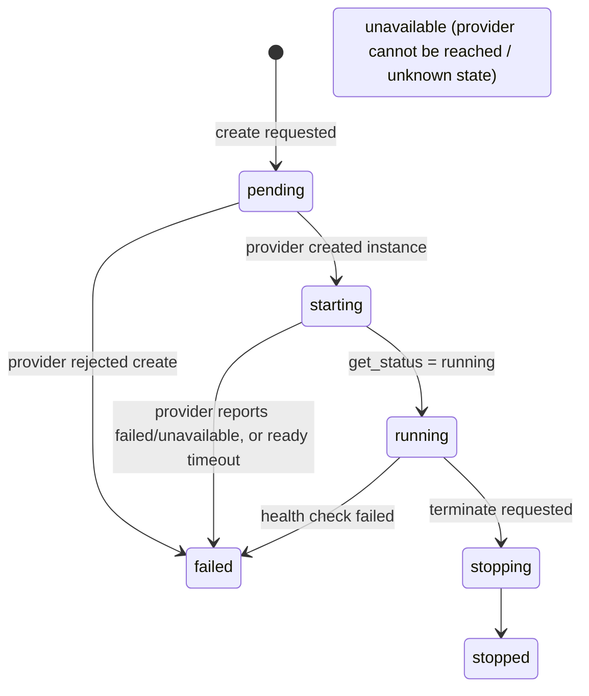
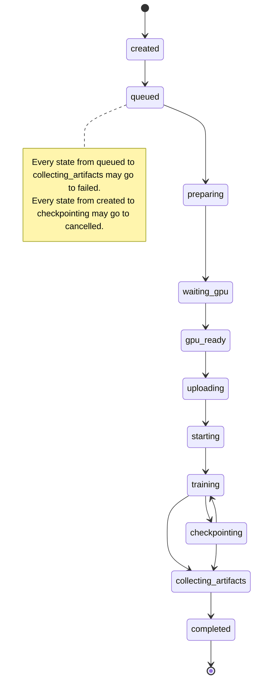

# Design

One-page overview of how a fine-tuning job runs and where the trust boundaries are.

## GPUProvider abstraction

The backend never talks to a GPU vendor directly. `GPUService` ([gpu_service.py](../apps/api/app/services/gpu_service.py)) drives an abstract `GPUProvider` ([base.py](../apps/api/app/infrastructure/gpu/base.py)) with nine async methods: `create_instance`, `terminate_instance`, `get_status`, `upload_files`, `download_files`, `execute_command`, `stream_logs`, `health_check`, `list_instances`. `create_gpu_provider` picks the implementation from `GPU_PROVIDER`:

| `GPU_PROVIDER` | Implementation | Runs the agent as |
|---|---|---|
| `local` | `LocalDockerProvider` | a container on this machine's NVIDIA GPU (Docker Engine API) |
| `runpod` | `RunPodProvider` | a RunPod pod built from `RUNPOD_TEMPLATE_ID` |

Both providers start the same **GPU runtime agent** (`gpu-agent/`), and the backend then speaks only the agent's HTTP API. Adding a provider means implementing those nine methods. Nothing above `GPUService` changes. `GPUService` adds what every provider needs: retries with backoff for retryable errors, waiting until the instance is `running` and healthy, terminating the instance on failure, and a per-user ownership check.

## State machines

**GPU instance** (`GPUInstanceStatus`, 7 values). These statuses are written from what the provider reports. No transition table validates them. The paths `GPUService` produces are:

**Training job** (`TrainingJobStatus`, 13 values). These transitions are enforced by `TrainingStateMachine`, and any transition not listed raises an error. Terminal states (`completed`, `failed`, `cancelled`) accept no transitions.

## Dataset pipeline

1. **Discover.** Search Hugging Face, Kaggle, GitHub, or the built-in demo dataset. Hugging Face metadata and previews use the Hub API (`/api/datasets/{id}`) and the dataset viewer API (`datasets-server.huggingface.co/first-rows`, `/splits`). No files are downloaded.
2. **Map.** `SemanticMappingService` asks an LLM which columns are the user prompt, assistant reply, system prompt, and context. Results are cached in Redis.
3. **Normalize.** Rows are paged from the provider (Hugging Face `/rows`, 100 rows per page). Each batch is validated, converted to chat `messages`, and streamed to `storage/datasets/<user>/<project>/<source>/<dataset>/<split>.jsonl`. `DATASET_MAX_ROWS` caps the row count. If any batch is invalid, or a download fails, the partially written file is deleted.
4. **Validate.** `DatasetValidationService` runs 7 checks: mapping lacks a user or assistant column, empty user prompt, empty assistant reply, mapped column missing from a row, value longer than 16,000 characters, text that is not valid UTF-8, and duplicate rows. Duplicates are a warning. The other checks are errors.
5. **Train.** A job may only reference a normalized file inside `STORAGE_PATH`. The worker uploads that file and a JSON config to the agent, starts an approved template, polls `/status`, and records metrics, checkpoints, and artifacts.

## Security boundaries

| Boundary | Enforcement |
|---|---|
| Browser → API | JWT bearer token (HS256, `JWT_SECRET_KEY`, 60 min expiry). `get_current_user` rejects a missing, malformed, wrongly signed, or expired token, and a token for an unknown or inactive user, with 401. |
| User → another user's job or pod | `TrainingService._require_owned_job` and `GPUService._require_owned_instance` compare `user_id` on every per-resource call. Job read and mutate routes return 403. Metrics, checkpoint, and artifact routes return 404. Job lists are filtered by user. |
| Worker → GPU agent | Shared `GPU_AGENT_TOKEN` bearer token on every agent route (constant-time compare). The agent fails closed: it refuses to start without a token, and if it is served without that startup check, every request gets 503. Both providers inject the token into the agent container or pod. RunPod pod metadata is stored without `env`, so the token never reaches users. |
| Agent → code execution | `/train` accepts only the templates `llama`, `qwen`, `gemma`, `mistral` (case-insensitive). `/commands` allows `mkdir`, `cp`, `mv`, `ls`, and `python` only when the script is inside a template directory. `pip` is not allowed. Every argument of `mkdir`/`cp`/`mv`/`ls` must be a short flag or a path that resolves (symlinks included) inside the workspace. Long options are rejected. `PATH`, `LD_*`, `DYLD_*` and `PYTHON*` cannot be set through the command `env`. |
| Local provider | The API and worker mount the Docker socket, which grants control of the host. This is for local demos only and must never be used on a public host. |

Known gaps: one `GPU_AGENT_TOKEN` is shared by every pod, and Docker Compose falls back to the public example value `change-me-runtime-agent-token` when none is set. Arguments passed to an approved template script under `python` are not checked.
